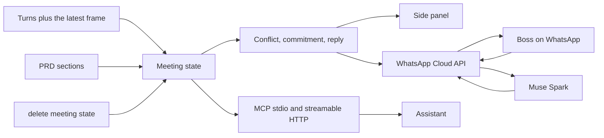

# Escort

**Pitch:** Escort is a live scope-creep guard for Taglish client calls. It escorts Muse through the meeting. This is not a recorder. It holds one meeting's live state, flags the moment you are about to agree to something the PRD forbids, and deletes that state when the call is over.

The state is the product: PRD sections, Me and Them turns, commitments (who, what, when), open items, and the last frame that actually changed. A conflict card is pushed onto the panel on its own, while the line is still going or in the instant after it ends. It cites the PRD section and carries a crop of the screen region as evidence. You do not query for it.

For the hackathon the brain that writes the cards is Muse Spark. Any other MCP client can sit in the same chair. Boss's phone-side chat is WhatsApp, through Meta's WhatsApp Cloud API. It is not Messenger, and it does not use a Facebook Page. No bot joins the call. The PRD markdown is passed in full with the turn. There is no vector index.

Judge line: Screenpipe remembers everything. Escort taps you on WhatsApp at the moment you're about to agree to something that breaks your PRD.

## Consent and retention

The bundled demo is a staged mock meeting. BayaniPay is fictional. The voices are synthesized. Nothing joins a Teams call, and no real client was recorded.

Live use still needs the people on the call to know a transcript is being made. Raw audio is not stored. Older frames are dropped. `delete_meeting_state` (or the Delete button, or `python -m escort delete`) wipes turns, cards, commitments, open items, and the last frame.

Another tool that already watches a screen, such as Screenpipe, can feed this same state. This layer is the guard, not the tape.

## Architecture



WhatsApp is only the phone pipe. Muse stays the brain. A card is pushed as an interactive message while the 24-hour customer-service window is open. Outside that window the card waits, and the next inbound text tells Boss to send `start meeting`.

Card types, and only these three:

| Type | What it means |
| --- | --- |
| `PRD_CONFLICT` | Pushed without a query. Cites `prd_section` and attaches the screen region. |
| `COMMITMENT` | Who promised what, and when. |
| `SUGGESTED_REPLY` | One natural Taglish line the user can say. |

`what_did_i_miss` is a small side tool. It reads the open items and promises. It does not create a fourth card.

`latency_ms` on each card is the time from the end of the triggering utterance to the card. The target is under 5 seconds. `get_live_context` also returns `latency.p50_ms` and `latency.p95_ms`. A card pushed while the person is still talking is stamped near 0 ms once the line ends, because it was already on the panel.

## Install on Windows

Download `EscortSetup.exe` from the GitHub Actions artifact named `EscortSetup` on the Windows installer workflow. Run it. The wizard asks for a folder, can add a Start Menu shortcut and an optional desktop shortcut, and can launch Escort when it finishes. Uninstall from Add or Remove Programs.

The installer is unsigned. Windows SmartScreen may say it protected your PC. Choose More info, then Run anyway, if you trust this build.

## Dev

`python -m escort ...` still works. The window is a separate command.

```bash
python -m venv .venv
. .venv/bin/activate
pip install -e ".[dev]"
pip install fastapi uvicorn pywebview pystray keyring
cd desktop/ui && npm install && npm run build && cd ../..
python -m escort desktop --web --demo
```

Open http://127.0.0.1:8750. MCP stays on http://127.0.0.1:8747/mcp. The WhatsApp webhook stays on port 8748.

### Pre-meeting context (Context screen)

- **Upload** PDF, DOCX, MD, or TXT (drag-and-drop or picker). Text is extracted locally (`pypdf`, `python-docx`), chunked by headings, and stored per meeting with `source · title` labels.
- **Connectors** (pluggable `ContextSource`): Notion pages, Google Docs / Sheets / Slides you paste a link to, Drive files you pick in Google's file chooser, Google Calendar upcoming events. Each person connects their own accounts (Connect Google opens their own browser sign-in; Notion takes their own integration token). Nothing in the code or the default installer names or contains any account. Tokens live in Windows Credential Manager via `keyring` (`notion_oauth_token`, `google_oauth_token`) — never in the repo.
- **Auto-match**: On Live, **Upcoming meetings** lists mock or real calendar events. **Prep** scores uploaded + connector items against title, attendees, description, and linked-doc hints; confirm on Context to merge into live notes.
- **Prep chat**: Taglish-friendly Muse Spark (`muse-spark-1.3`) over loaded context.
- **WhatsApp**: send `prep` for a text summary of the next meeting’s matched context.
- **Demo mode**: set `ESCORT_CONNECTORS=mock` (default when no tokens) for fictional BayaniPay calendar + Notion/Google fixtures (a pasted Docs, Sheets or Slides link, or a picked Drive file, resolves to a labeled demo item).

OAuth setup (Boss):

1. **Notion** — Create an integration at https://www.notion.so/my-integrations, copy the internal integration secret, share target pages/databases with the integration, paste the token in Setup (saved as `notion_oauth_token`).
2. **Google** — In Google Cloud Console create a project and an OAuth client (type Desktop app), then:
   - **Enable these APIs:** Google Calendar, Google Docs, Google Sheets, Google Slides, Google Drive and Google Picker.
   - **OAuth consent screen:** declare the scopes below (all "sensitive", none "restricted"; no Google security assessment). While the app is in Testing, add every user under **Test users**.
   - **API key (only for Pick from Drive):** APIs & Services > Credentials > Create credentials > API key, then restrict it to the **Google Picker API** (and, optionally, HTTP referrers `http://127.0.0.1:*`). It is a browser key, not a secret, but Escort still hands it only to its own local window.
   - In Escort press **Connect Google** and sign in with your own account (standard PKCE loopback flow; tokens refresh and live in the Windows keyring). The older "paste a bearer token" route (`POST /api/connectors/token`) still works for demos.

   Scopes per capability. Only the first row is asked at sign-in; every other row is asked with incremental consent (`include_granted_scopes=true`, Google shows just the new box) the first time you use it:

   | Capability | Scopes | Asked when |
   | --- | --- | --- |
   | Calendar + Docs links (sign-in) | `calendar.readonly`, `documents.readonly` | Connect Google |
   | Sheets links | `spreadsheets.readonly` | first Sheets link (**Allow Sheets access**) |
   | Slides links | `presentations.readonly` | first Slides link (**Allow Slides access**) |
   | Pick from Drive | `drive.file` | first pick (**Allow Drive file picking**) |
   | Save notes to Drive | `drive.file`, `documents` | turning the toggle on (**Allow note saving**) |

   (All are under `https://www.googleapis.com/auth/`.) Escort never asks for Drive-wide read access and has no Drive search.

   **Import from Google** (Context). Paste a `docs.google.com/document/d/…`, `/spreadsheets/d/…` or `/presentation/d/…` link; the type is detected from the link (a bare id gets a Docs / Sheets / Slides switch). Escort reads that one file and adds it labeled "Google Docs", "Google Sheets" or "Google Slides", split into the same cited sections the Notion importer produces:
   - Docs: `documents.get`; headings, paragraphs, lists and tables.
   - Sheets: `spreadsheets.get` (no grid data) for the tab names, then one `values.batchGet`; one markdown table per tab, capped at 200 rows x 30 columns per tab and 20 tabs, with a note when something was cut.
   - Slides: `presentations.get`; one section per slide (`Slide N: <title>`) with text from shapes, tables and groups, plus speaker notes.

   Forms, Drawings, published-to-the-web and `drive.google.com` links are refused with a pointer to Pick from Drive. A 404/403 says the file is not shared with the connected account, a disabled API links to the page that enables it, a missing scope returns `code: needs_<docs|sheets|slides|drive>_consent` with `capability` so the UI shows the right **Allow … access** button (and retries on its own once Google grants it), and an expired session asks you to connect again.

   **Pick from Drive** (Context). Opens Google's own file chooser (Picker, loaded lazily from `apis.google.com`; an offline or blocked load shows a clear message). The page gets `GET /api/google/picker-config` → `{api_key, app_id, access_token, scope_ok, ready, reason}` (loopback callers and local origins only, `Cache-Control: no-store`, never the client secret; the token is refreshed first when it is about to expire). `app_id` is the Cloud project number, i.e. the client ID up to its first `-`. The picked file goes to `POST /api/context/import-drive-file {id, mimeType, name}`; the backend re-reads the file's metadata (type and size come from Google, not the browser), downloads PDF / DOCX / TXT / MD with `files.get?alt=media` or exports Google Docs (Markdown, falling back to text), Sheets (CSV → table, same caps) and Slides (text), refuses anything over 15 MB, runs the same extractor as uploads, and adds it labeled "Google Drive". With `drive.file` Escort can open only the files you pick.

   **Google app credentials (client ID + secret + API key).** Nothing is hardcoded and the default installer contains none. Lookup order: env (`ESCORT_GOOGLE_CLIENT_ID` / `ESCORT_GOOGLE_CLIENT_SECRET` / `ESCORT_GOOGLE_API_KEY`) > saved Setup (Connect accounts > Google > "Google app credentials": ID in `config.json`, secret and API key in the Windows keyring) > a per-user file `%APPDATA%\Escort\google_client.json` (`~/.config/Escort/google_client.json` off Windows) > an optional file next to `Escort.exe`. The secret and API key always come from the same source as the client ID, so the key and the App ID belong to one project. Both files use this format (`api_key` optional):

   ```json
   {"client_id": "YOUR_CLIENT_ID.apps.googleusercontent.com", "client_secret": "YOUR_CLIENT_SECRET", "api_key": "YOUR_PICKER_API_KEY"}
   ```

   `packaging/escort.iss` does **not** bundle `google_client.json` unless you opt in: `ISCC /DBundleGoogleClient=1 packaging\escort.iss` with a git-ignored `google_client.json` in the repo root. `/api/status` reports only whether credentials are configured, their source (`env`, `setup`, `user_file` or `bundled`) and `has_client_secret` / `has_api_key`; the secret and key are never returned there or logged.

### Saving meeting notes (optional, off by default)

Escort only ever writes when you click: **Note it** on a commitment card (Live) or **Save to Google Docs / Save to Notion** on Recap > Summary. Nothing is written from heard speech. Prep chat understands "save summary to Docs" / "save this to my notes", but only saves after you reply yes. Re-saving a summary appends a new dated section; nothing is overwritten. When both destinations are on, you pick one (the last choice is remembered).

**Google Docs.** Turn on **Save notes to Drive** in Connections > Google. (Needs the Drive API enabled; its `drive.file` grant also covers Pick from Drive.) Escort then asks Google (incremental consent, same PKCE/loopback flow, `include_granted_scopes=true`) for two extra scopes only:

- `https://www.googleapis.com/auth/drive.file`: only files Escort creates or that you pick
- `https://www.googleapis.com/auth/documents`

It never requests the full `drive` scope. On the OAuth consent screen either add the two scopes above or let Escort request them. Escort makes one folder named `Escort` and one Google Doc per meeting titled `Escort · <meeting> · <YYYY-MM-DD>`, and refuses to edit any doc it did not create. Turning the toggle off just stops writing; to remove access entirely use https://myaccount.google.com/permissions. A token without the scopes shows **Allow note saving** instead of a raw 403; a disabled Docs API says how to enable it.

**Notion.** In https://www.notion.so/profile/integrations (your own workspace) give your integration the **Insert content** and **Update content** capabilities, and share a parent page with it (page menu > Connections). Then turn on **Save notes to Notion** in Connections > Notion and pick that parent page from the search. Escort creates one child page per meeting under it. A `403 restricted_resource` from Notion is shown as "give the integration Insert/Update content and share the page".

**Update an existing Notion page.** Notion can also keep your existing notes current, like Google Docs. In Connections > Notion use **Choose a page to keep updated** (from the same search; the page must be shared with the integration). Escort keeps a registry of the pages you picked (id, title, picked_at in `config.json`) next to the pages it created itself, and the write guard refuses every other page id before any request is made. Updates read the page's current blocks first (same block-to-text as the importer) so edits are targeted: append blocks, add a bulleted or checkbox item at the end of a heading's section (for a commitment, under **Commitments**; the heading is created if missing), or replace one block's text (`PATCH /v1/blocks/{id}`, only a block that is on the page). Updates are never automatic: **Note it** and **Save summary** gain an "Update: <page>" destination that first shows a preview ("Add to <page> under Commitments: - Pia: send SOW by Friday") with Confirm / Cancel, and prep chat ("update my CRM notes page with this") resolves the page by title among the picked pages, shows what it would add, and writes only after you reply yes. API: `POST /api/connectors/notion/targets {add: {id, title}}` or `{remove: id}`; `POST /api/notes/notion/update/preview {page_id, kind: "commitment" | "summary" | "edit", card_id?, block_id?, text?}` returns `{plan_id, summary, lines}` and writes nothing; `POST /api/notes/notion/update/confirm {plan_id}` performs it; `.../cancel {plan_id}` discards it.

API: `POST /api/notes/drive` and `POST /api/notes/notion` take `{kind: "commitment" | "summary", card_id?}` and return `{ok, doc: {id, url, title}}`; `GET` on the same paths returns the current meeting's doc/page. Toggles: `POST /api/connectors/google/notes {enabled}`, `POST /api/connectors/google/consent {capability?: "notes" (default) | "docs" | "sheets" | "slides" | "drive_files"}`, `POST /api/connectors/notion/notes {enabled, parent_id?, parent_title?}`.

## Run the staged demo

```bash
python -m venv .venv
. .venv/bin/activate
pip install -e ".[dev]"
python -m escort replay
```

That prints the cards. The default transcriber is the scripted fixture, so the demo does not need a key. The WAV files are still read and timed.

Two processes for the side panel:

```bash
python -m escort serve --replay --pace-ms 900 --port 8747
```

```bash
cd panel
npm install
npm run dev
```

Open [http://127.0.0.1:4319](http://127.0.0.1:4319). Cards show a timestamp and a latency number. The crop on "yung nasa taas" is the top of the shared fee screen.

`scripts/demo.sh` starts both.

Swap in real models when you have a key:

```bash
export MODEL_API_KEY="LLM_..."
python -m escort serve --replay --transcriber muse --spark muse --segmenter sam --port 8747
```

`META_API_KEY` is accepted as an alias. The official name in Meta's docs is `MODEL_API_KEY`.

## Feeding a live call on Windows

Live mode does not join the meeting. It turns the call into meeting state and drops the audio after each turn is text.

```powershell
python -m venv .venv
.venv\Scripts\Activate.ps1
pip install -e ".[windows,whisper]"
$env:MODEL_API_KEY = "LLM_..."
python -m escort live --transcriber muse --spark auto --segmenter auto --port 8747
```

- Me is the default WASAPI microphone, via PyAudioWPatch.
- Them is the loopback device for the default speakers, so Teams audio is its own stream.
- Both are converted to mono 16-bit PCM at 24 kHz, which is what Muse Voice Transcribe wants on the realtime socket.
- The screen is grabbed at about 1 fps with mss. A perceptual hash plus a downscaled mean difference drops frames that did not change.
- With a key, each stream opens its own `wss://api.meta.ai/v1/asr/realtime` session in `ENDPOINTING` mode, with `languageBias` `["Tagalog", "English"]`. Diarization is unnecessary because the streams are already split.
- Without a key, live mode uses faster-whisper on voiced chunks if that extra is installed. It will not pretend the scripted fixture is a live transcript.

This path was not executed in the Linux environment that built the repo. The device picker and the resampler have unit tests. The WASAPI open call needs Windows.

## MCP

Tools:

| Tool | Returns |
| --- | --- |
| `push_suggestion` | The hero. Lands a card on the panel without anyone asking. Conflicts from the guard use this same door. |
| `get_live_context` | Meeting state, recent cards, the last frame, and latency p50/p95 |
| `get_latest_frame` | The one changed frame still kept |
| `get_cards` | The three card types, each with `latency_ms` |
| `what_did_i_miss` | A short side summary of open items and promises |
| `delete_meeting_state` | Wipes the meeting |

Stdio, for any local MCP client. Set the working directory to this repo. See `examples/mcp.json`.

```json
{
  "mcpServers": {
    "escort": {
      "command": "python",
      "args": ["-m", "escort", "serve", "--transport", "stdio", "--replay"]
    }
  }
}
```

Streamable HTTP, for a remote or plugin-style client:

```bash
python -m escort serve --replay --port 8747
```

```json
{
  "mcpServers": {
    "escort": {
      "url": "http://127.0.0.1:8747/mcp"
    }
  }
}
```

The side panel is not an MCP client. It reads the same meeting state over `GET /panel/state`, proxied by Next.js at `/listener/state`. Delete on the panel calls `POST /panel/delete`.

Me and Them stay separate labels when a Windows session is feeding the state: the microphone is Me, the speaker loopback is Them. That split is how turns get a speaker. It is an input, not the product. SAM 3.1 has one job here: when the line says "ito", "yung nasa taas", or "this", it masks that region and the crop sticks to the conflict card. If SAM is unavailable, the crop is the share area.

## Day-1 eval

Word error rate is an edit distance over lowercase tokens. Latency is the time the transcriber takes to return.

```bash
python -m escort.eval_day1 --hypothesis fixtures/eval/reference.txt
python -m escort eval --backend muse
python -m escort record
python scripts/record_eval.py
```

`record` reads three Taglish BayaniPay lines into the Windows mic and writes 24 kHz mono WAVs plus the reference text under `fixtures/eval/real/`. Then:

```bash
python -m escort eval --backend muse --audio fixtures/eval/real/01.wav --reference fixtures/eval/real/01.txt
```

`auto` calls Muse Voice Transcribe when `MODEL_API_KEY` is set, otherwise faster-whisper if it is installed. With neither, the script exits 2 and does not report the scripted fixture as a recognition score. `--backend scripted` is labeled `measures_recognition: false`.

The clip is `fixtures/eval/taglish.wav`. The reference is `fixtures/eval/reference.txt`.

## WhatsApp

Boss's phone chat is the WhatsApp Cloud API. Not Messenger. Not a Facebook Page. The Graph host is still `graph.facebook.com`. That is the documented WhatsApp Cloud API host.

`start meeting` is step one on camera. That text opens the session and WhatsApp's 24-hour customer-service window, counted from the inbound message. Then drop the PRD in the chat as a document. The sample PRD in this repo is fictional. BayaniPay is not a real company.

Inside the window, a PRD conflict arrives as one interactive message with exactly three buttons: Raise it, Suggest reply, and Ignore. When a SAM or screen crop exists, that image is the message header. Tap Suggest reply and a Taglish line comes back. Commitments arrive as an interactive list of open items. Outside the window, cards wait, and the next inbound text tells Boss to send `start meeting`.

Each push logs a timing breakdown to the console: `webhook_ms` for the handler, `muse_ms` for model time from the end of the turn, and `graph_ms` for the Graph API send. `e2e_ms` is those three added together. The conflict push target is under about 5 seconds to the phone, not just model time.

```bash
python -m escort whatsapp --port 8748
python -m escort whatsapp --demo
```

`--demo` replays a fake webhook with a mocked Graph API, so you can see the thread without a real number. The live server reads meeting state from `ESCORT_STATE_URL` (default `http://127.0.0.1:8747/panel/state`) and only pushes cards that show up after it starts.

### Setup

This test-number and allowlist setup is a hackathon demo. It is not production-ready. The free test number only delivers to numbers you add by hand.

1. Create a Meta developer app and add the WhatsApp product. Do not add Messenger. Do not create a Facebook Page for this.
2. In WhatsApp, API setup, use the free test business number.
3. Add up to five recipient numbers for the demo. One of them is Boss's phone. Those numbers go in `WHATSAPP_ALLOWED_NUMBERS`.
4. Run the webhook on port 8748 and expose it with a Cloudflare tunnel:

```bash
python -m escort whatsapp --port 8748
cloudflared tunnel --url http://127.0.0.1:8748
```

5. In the app dashboard, set the callback URL to `https://<tunnel-host>/webhook`, set the verify token to the same value as `WHATSAPP_VERIFY_TOKEN`, and subscribe to the `messages` field.
6. Put the tokens in the environment. Never commit them.

| Variable | Role |
| --- | --- |
| `WHATSAPP_VERIFY_TOKEN` | Handshake token you choose |
| `WHATSAPP_APP_SECRET` | Optional. When set, `X-Hub-Signature-256` is required |
| `WHATSAPP_ACCESS_TOKEN` | Cloud API token for sending |
| `WHATSAPP_PHONE_NUMBER_ID` | Test number id, not the display phone number |
| `WHATSAPP_ALLOWED_NUMBERS` | Comma-separated. Only these numbers get replies |
| `WHATSAPP_GRAPH_VERSION` | Default `v22.0` |
| `ESCORT_STATE_URL` | Live meeting snapshot. Default `http://127.0.0.1:8747/panel/state` |
| `MODEL_API_KEY` | Muse. `META_API_KEY` also works. Unset keeps the local read |

A PDF, Markdown, DOCX, or text file sent in the chat becomes the meeting PRD. Images are stored as context.

## Staged scenario

The staged client is fictional. The PRD is fictional. No real company data is in the repo. The client asks to pull payment integration into Phase 1. The PRD says that work is Phase 2 (section 2.2). The client shares a dashboard and says "yung nasa taas, i-adjust natin" about the 2.4 percent fee. The user says they will check with product, then that they will confirm the fee with finance.

Regenerate the synthesized audio and the fake screens with `python scripts/build_fixtures.py` if you have espeak-ng and ffmpeg. The committed files are enough to run the demo.

## Tests

```bash
pytest
```

## Meta APIs: verified vs assumed

Checked against the public docs on dev.meta.ai on 30 Oct 2026. Nothing in this environment called the live API. There is no key in the repo.

Verified from the docs, and encoded in the adapters:

| Piece | What the docs say |
| --- | --- |
| Base URL | `https://api.meta.ai/v1` |
| Auth | `Authorization: Bearer $MODEL_API_KEY` on HTTP. The realtime socket ignores that header and wants `authorization.accessToken` in the first JSON frame. |
| Muse Voice Transcribe | Model `muse-voice-transcribe-1.0`. Live and file playback prefer `wss://api.meta.ai/v1/asr/realtime` (`ENDPOINTING`, PCM at real-time pace, then `{"type":"endStream"}`). If the socket fails, the batch fallback is `POST /v1/asr/transcribe`. |
| Audio | WAV or PCM, mono, 16-bit, 16 kHz or 24 kHz. `PCM_24KHZ` on the socket. `audioEncoding: "WAV"` on the file call. |
| Language | `languageBias: ["Tagalog", "English"]`. Tagalog is one of the 25 listed languages. The hint does not force a language. `keywords` biases names. |
| Turns | `ENDPOINTING` emits `speechStart`, partial `transcript`, `speechEnd`, `speechComplete`. The stream label Me or Them wins over a diarization letter. |
| Muse Spark | `POST /v1/chat/completions`, model `muse-spark-1.3` only. The `-contributor` id is rewritten to `muse-spark-1.3`. `reasoning_effort` is `minimal` (`none` is rejected). `max_completion_tokens` is 1600 so the reply is not an empty reasoning cap. |
| SAM 3.1 | `POST /v1/responses`, model `sam-3.1`. User message with `input_text` (a short noun phrase) and `input_image` whose `image_url` is a string, including a data URL. Boxes come back as `<\|box;x1=..;y1=..;x2=..;y2=..;w=..;h=..|>`. Docs say spatial phrases are unreliable, so the noun is plain ("percentage") and this repo picks the box that sits in the deictic region. |

Assumed, because it was not executed against the API:

- The non-streaming SAM body is the usual Responses payload. The parser walks `text` and `output_text` fields and also scans the raw body for box tokens, including an SSE `data:` fallback.
- Chat completion `message.content` is usually a string under `json_schema`. A list of text parts is accepted too.
- `json_schema.strict` was not in the schema example we used, so it is not sent.
- PyAudioWPatch's loopback device is selected by matching the default output name. That matches the library's own WASAPI pattern and was not run here.
- faster-whisper `small` is the open-weights fallback. It is not a Meta model, and a single Whisper language id is a weak fit for code-switching. The initial prompt carries the Taglish hint.
- The rules engine is the offline spark so the mock meeting still emits all three card types with no key. It is not Muse Spark. Cards are labeled `rules-fallback`.
- The scripted transcriber is the offline file transcriber for the staged WAV. It checks the file is a real WAV, then returns the script line. It is labeled `scripted-fixture`.

Env:

| Variable | Role |
| --- | --- |
| `MODEL_API_KEY` | Official key. `META_API_KEY` also works. |
| `META_API_BASE` | Default `https://api.meta.ai/v1` |
| `META_ASR_MODEL` | Default `muse-voice-transcribe-1.0` |
| `META_SPARK_MODEL` | Default `muse-spark-1.3` |
| `META_SAM_MODEL` | Default `sam-3.1` |
| `LISTENER_URL` | Panel proxy target, default `http://127.0.0.1:8747` |

Copy `.env.example` to `.env` if you want the names in one place. `.env` is gitignored. Do not commit a key.
