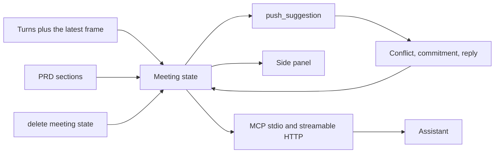

# Taglish scope guard

**Pitch:** This is not a recorder. It holds one meeting's live state, flags the moment you are about to agree to something the PRD forbids, and deletes that state when the call is over.

The state is the product: PRD sections, Me and Them turns, commitments (who, what, when), open items, and the last frame that actually changed. A conflict card is pushed onto the panel on its own, while the line is still going or in the instant after it ends. It cites the PRD section and carries a crop of the screen region as evidence. You do not query for it.

For the hackathon the brain that writes the cards is Muse Spark. Any other MCP client can sit in the same chair. The PRD markdown is passed in full with the turn. There is no vector index.

## Consent and retention

The bundled demo is a staged mock meeting. BayaniPay is fictional. The voices are synthesized. Nothing joins a Teams call, and no real client was recorded.

Live use still needs the people on the call to know a transcript is being made. Raw audio is not stored. Older frames are dropped. `delete_meeting_state` (or the Delete button, or `python -m taglish_listener delete`) wipes turns, cards, commitments, open items, and the last frame.

Another tool that already watches a screen, such as Screenpipe, can feed this same state. This layer is the guard, not the tape.

## Architecture



Card types, and only these three:

| Type | What it means |
| --- | --- |
| `PRD_CONFLICT` | Pushed without a query. Cites `prd_section` and attaches the screen region. |
| `COMMITMENT` | Who promised what, and when. |
| `SUGGESTED_REPLY` | One natural Taglish line the user can say. |

`what_did_i_miss` is a small side tool. It reads the open items and promises. It does not create a fourth card.

`latency_ms` on each card is the time from the end of the triggering utterance to the card. The target is under 5 seconds. `get_live_context` also returns `latency.p50_ms` and `latency.p95_ms`. A card pushed while the person is still talking is stamped near 0 ms once the line ends, because it was already on the panel.

## Run the staged demo

```bash
python -m venv .venv
. .venv/bin/activate
pip install -e ".[dev]"
python -m taglish_listener replay
```

That prints the cards. The default transcriber is the scripted fixture, so the demo does not need a key. The WAV files are still read and timed.

Two processes for the side panel:

```bash
python -m taglish_listener serve --replay --pace-ms 900 --port 8747
```

```bash
cd panel
npm install
npm run dev
```

Open [http://127.0.0.1:4319](http://127.0.0.1:4319). Cards show a timestamp and a latency number. The crop on "yung nasa taas" is the top of the shared fee screen.

`scripts/demo.sh` starts both.

Swap in real models when you have a key:

```bash
export MODEL_API_KEY="LLM_..."
python -m taglish_listener serve --replay --transcriber muse --spark muse --segmenter sam --port 8747
```

`META_API_KEY` is accepted as an alias. The official name in Meta's docs is `MODEL_API_KEY`.

## Feeding a live call on Windows

Live mode does not join the meeting. It turns the call into meeting state and drops the audio after each turn is text.

```powershell
python -m venv .venv
.venv\Scripts\Activate.ps1
pip install -e ".[windows,whisper]"
$env:MODEL_API_KEY = "LLM_..."
python -m taglish_listener live --transcriber muse --spark auto --segmenter auto --port 8747
```

- Me is the default WASAPI microphone, via PyAudioWPatch.
- Them is the loopback device for the default speakers, so Teams audio is its own stream.
- Both are converted to mono 16-bit PCM at 24 kHz, which is what Muse Voice Transcribe wants on the realtime socket.
- The screen is grabbed at about 1 fps with mss. A perceptual hash plus a downscaled mean difference drops frames that did not change.
- With a key, each stream opens its own `wss://api.meta.ai/v1/asr/realtime` session in `ENDPOINTING` mode, with `languageBias` `["Tagalog", "English"]`. Diarization is unnecessary because the streams are already split.
- Without a key, live mode uses faster-whisper on voiced chunks if that extra is installed. It will not pretend the scripted fixture is a live transcript.

This path was not executed in the Linux environment that built the repo. The device picker and the resampler have unit tests. The WASAPI open call needs Windows.

## MCP

Tools:

| Tool | Returns |
| --- | --- |
| `push_suggestion` | The hero. Lands a card on the panel without anyone asking. Conflicts from the guard use this same door. |
| `get_live_context` | Meeting state, recent cards, the last frame, and latency p50/p95 |
| `get_latest_frame` | The one changed frame still kept |
| `get_cards` | The three card types, each with `latency_ms` |
| `what_did_i_miss` | A short side summary of open items and promises |
| `delete_meeting_state` | Wipes the meeting |

Stdio, for any local MCP client. Set the working directory to this repo. See `examples/mcp.json`.

```json
{
  "mcpServers": {
    "taglish-listener": {
      "command": "python",
      "args": ["-m", "taglish_listener", "serve", "--transport", "stdio", "--replay"]
    }
  }
}
```

Streamable HTTP, for a remote or plugin-style client:

```bash
python -m taglish_listener serve --replay --port 8747
```

```json
{
  "mcpServers": {
    "taglish-listener": {
      "url": "http://127.0.0.1:8747/mcp"
    }
  }
}
```

The side panel is not an MCP client. It reads the same meeting state over `GET /panel/state`, proxied by Next.js at `/listener/state`. Delete on the panel calls `POST /panel/delete`.

Me and Them stay separate labels when a Windows session is feeding the state: the microphone is Me, the speaker loopback is Them. That split is how turns get a speaker. It is an input, not the product. SAM 3.1 has one job here: when the line says "ito", "yung nasa taas", or "this", it masks that region and the crop sticks to the conflict card. If SAM is unavailable, the crop is the share area.

## Day-1 eval

Word error rate is an edit distance over lowercase tokens. Latency is the time the transcriber takes to return.

```bash
python -m taglish_listener.eval_day1 --hypothesis fixtures/eval/reference.txt
python -m taglish_listener eval --backend muse
```

`auto` calls Muse Voice Transcribe when `MODEL_API_KEY` is set, otherwise faster-whisper if it is installed. With neither, the script exits 2 and does not report the scripted fixture as a recognition score. `--backend scripted` is labeled `measures_recognition: false`.

The clip is `fixtures/eval/taglish.wav`. The reference is `fixtures/eval/reference.txt`.

## Staged scenario

Client asks to pull payment integration into Phase 1. The PRD says that work is Phase 2 (section 2.2). The client shares a dashboard and says "yung nasa taas, i-adjust natin" about the 2.4 percent fee. The user says they will check with product, then that they will confirm the fee with finance.

Regenerate the synthesized audio and the fake screens with `python scripts/build_fixtures.py` if you have espeak-ng and ffmpeg. The committed files are enough to run the demo.

## Tests

```bash
pytest
```

## Meta APIs: verified vs assumed

Checked against the public docs on dev.meta.ai on 30 Oct 2026. Nothing in this environment called the live API. There is no key in the repo.

Verified from the docs, and encoded in the adapters:

| Piece | What the docs say |
| --- | --- |
| Base URL | `https://api.meta.ai/v1` |
| Auth | `Authorization: Bearer $MODEL_API_KEY` on HTTP. The realtime socket ignores that header and wants `authorization.accessToken` in the first JSON frame. |
| Muse Voice Transcribe | Model `muse-voice-transcribe-1.0`. File: `POST /v1/asr/transcribe` multipart `request` JSON plus `audio` WAV. Live: `wss://api.meta.ai/v1/asr/realtime`. |
| Audio | WAV or PCM, mono, 16-bit, 16 kHz or 24 kHz. `PCM_24KHZ` on the socket. `audioEncoding: "WAV"` on the file call. |
| Language | `languageBias: ["Tagalog", "English"]`. Tagalog is one of the 25 listed languages. The hint does not force a language. `keywords` biases names. |
| Turns | `ENDPOINTING` emits `speechStart`, partial `transcript`, `speechEnd`, `speechComplete`. The stream label Me or Them wins over a diarization letter. |
| Muse Spark | `POST /v1/chat/completions`, model `muse-spark-1.3`. Images go in an `image_url` part as a data URL. Structured output uses `response_format.type = json_schema`. `reasoning_effort: "none"` is rejected, so the loop sends `"low"`. Temperature is left at the default. |
| SAM 3.1 | `POST /v1/responses`, model `sam-3.1`. User message with `input_text` (a short noun phrase) and `input_image` whose `image_url` is a string, including a data URL. Boxes come back as `<\|box;x1=..;y1=..;x2=..;y2=..;w=..;h=..|>`. Docs say spatial phrases are unreliable, so the noun is plain ("percentage") and this repo picks the box that sits in the deictic region. |

Assumed, because it was not executed against the API:

- The non-streaming SAM body is the usual Responses payload. The parser walks `text` and `output_text` fields and also scans the raw body for box tokens, including an SSE `data:` fallback.
- Chat completion `message.content` is usually a string under `json_schema`. A list of text parts is accepted too.
- `json_schema.strict` was not in the schema example we used, so it is not sent.
- PyAudioWPatch's loopback device is selected by matching the default output name. That matches the library's own WASAPI pattern and was not run here.
- faster-whisper `small` is the open-weights fallback. It is not a Meta model, and a single Whisper language id is a weak fit for code-switching. The initial prompt carries the Taglish hint.
- The rules engine is the offline spark so the mock meeting still emits all three card types with no key. It is not Muse Spark. Cards are labeled `rules-fallback`.
- The scripted transcriber is the offline file transcriber for the staged WAV. It checks the file is a real WAV, then returns the script line. It is labeled `scripted-fixture`.

Env:

| Variable | Role |
| --- | --- |
| `MODEL_API_KEY` | Official key. `META_API_KEY` also works. |
| `META_API_BASE` | Default `https://api.meta.ai/v1` |
| `META_ASR_MODEL` | Default `muse-voice-transcribe-1.0` |
| `META_SPARK_MODEL` | Default `muse-spark-1.3` |
| `META_SAM_MODEL` | Default `sam-3.1` |
| `LISTENER_URL` | Panel proxy target, default `http://127.0.0.1:8747` |

Copy `.env.example` to `.env` if you want the names in one place. `.env` is gitignored. Do not commit a key.
