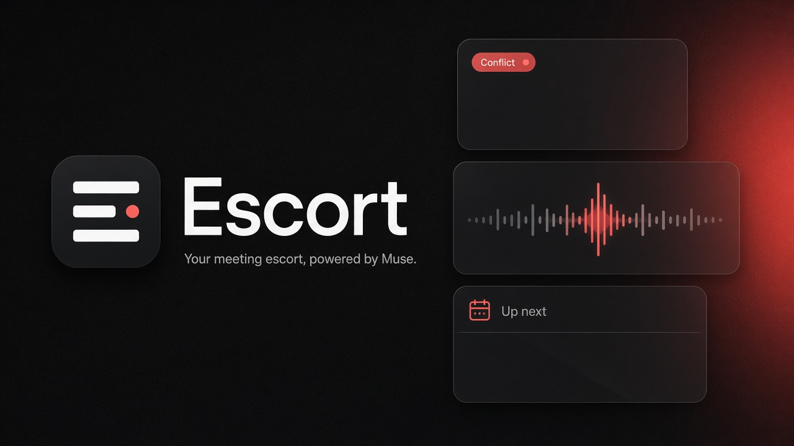
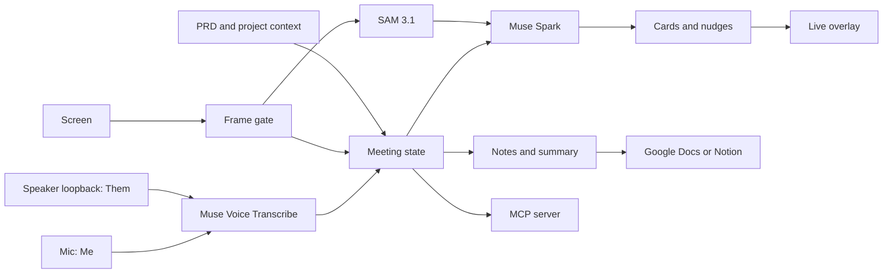

# Escort

**One place for all your scattered notes, and an AI that speaks up while the meeting is still running.**

Your notes live everywhere: PDFs, files and folders on your computer, Google Drive, Notion, a scrap in Notepad. Escort collects them per project, then sits beside your call as a small overlay. It listens to both sides, watches the shared screen, and checks what is said against everything you gave it. When something doesn't line up, you get a heads-up right then, while you can still ask about it.

No bot joins the call. Raw audio is never stored.

## Why Escort

Most AI note-takers summarize the meeting for you. You get the gist once the call is over, and that is the problem: if a client's request contradicts your earlier notes or the project documentation, you find out afterwards, and the fix is another email or another meeting to clear it up.

Escort moves that moment into the call. Because it already holds your notes and documents, it can say, mid-conversation, "your scope notes put manager roles out of Phase 1, but they just asked for one. Worth clarifying now." It also tells you when a promise has no owner or date, when the screen on show belongs to another project, or when you seem to have missed the meeting altogether. After the call it still writes your notes, so you get both.

Connect a calendar and each project's meetings show up under **Up next**, with the invite's join link ready, so Escort knows which project a call belongs to. If the conversation or the shared screen turns to a totally different project, it asks you about it, and offers to switch projects, instead of letting you carry on against the wrong notes.

| | A typical AI note-taker | Escort |
| --- | --- | --- |
| **When it helps** | After the call, as a summary | During the call as a heads-up, and after it as notes |
| **What it knows** | The transcript | The transcript, the screen, and all your notes and documents |
| **An inconsistency with your notes** | Found later, so another email or another meeting | Raised while everyone is still on the line |

- [Why Escort](#why-escort)
- [What it does](#what-it-does)
- [Built with Meta AI](#built-with-meta-ai)
- [How it works](#how-it-works)
- [Quick start](#quick-start)
- [Using Escort](#using-escort)
- [MCP server](#mcp-server)
- [Privacy and consent](#privacy-and-consent)
- [Development](#development)
- [Meta API notes](#meta-api-notes)
- [Roadmap](#roadmap)

## What it does

| | |
| --- | --- |
| **Inconsistency guard** | Flags the moment something said contradicts your notes or documents, such as a client asking for what the PRD puts out of scope. The card cites the section it conflicts with and carries a crop of the screen region being discussed. |
| **Proactive nudges** | Escort decides for itself when to speak up: "you don't seem to be in the meeting" (with the invite's join link), "noted on Jessa's RBAC update", "that promise has no date, ask this", "this screen belongs to another project", "5 minutes left with open items". Silence is the default. |
| **Live cards** | Three card types while you talk: `PRD_CONFLICT`, `COMMITMENT` (who promised what, by when) and `SUGGESTED_REPLY` (one natural Taglish line you can say). |
| **Smart screen capture** | An OBS-style frame gate sends a frame to the model only when the screen meaningfully changes. Mouse movement and an unchanged slide don't count. Charts, diagrams and wireframes are kept for the notes. |
| **Organized notes** | Jot notes in the overlay during the call. Afterwards Escort uses your jots as the skeleton and fills in the detail from the transcript, organized by topic and shaped by meeting type. You get highlights, takeaways, decisions and open questions, with no fixed length. |
| **Calendar-aware** | Events matched to a project appear as its upcoming meetings, with the join link. During the call Escort checks the talk and the screen against the project the event belongs to, and asks for clarification when they point somewhere else. |
| **All your notes, one place** | Per-project context from uploads (PDF, DOCX, Markdown, plain-text notes), local folders Escort keeps watching, Notion, and Google Docs, Sheets, Slides and Drive (search, or paste a file or folder link). Calendar events are matched to projects automatically. |
| **Save notes** | One click saves the summary to Google Docs or Notion. Nothing is written without your click. |

## Built with Meta AI

| Model | Where Escort uses it |
| --- | --- |
| **Muse Spark** (`muse-spark-1.3`) | The brain: live cards, the proactive nudge assessment (with a JSON schema and confidence floors), screen judgement against the active project, post-meeting notes and summaries (map-reduce for long calls), and Taglish prep chat over loaded context. |
| **Muse Voice Transcribe** (`muse-voice-transcribe-1.0`) | Realtime transcription over `wss://api.meta.ai/v1/asr/realtime`, one stream for you (mic) and one for them (speaker loopback), with a `["Tagalog", "English"]` language bias. Streams reconnect on their own and are padded with silence so a quiet call is never cut off. |
| **SAM 3.1** (`sam-3.1`) | When someone says "ito", "yung nasa taas" or "this", SAM masks that region of the shared screen and the crop is attached to the conflict card as evidence. |

Without a key, Escort still runs end to end on a rules engine and a scripted transcript, and labels every card `rules-fallback` so it is never confused with Muse output.

## How it works



The meeting state is the product: PRD sections, the turns for Me and Them, commitments, open items, your jots and the last frame that changed. Cards are pushed onto the overlay without being asked for, while the line is still being said or right after it ends. Each card carries `latency_ms` from the end of the triggering line; the target is under 5 seconds.

The rules for when Escort speaks up, and how it avoids nagging, are in [docs/proactive-meeting-agent.md](docs/proactive-meeting-agent.md).

## Quick start

### Install on Windows

Download `EscortSetup.exe` from the `EscortSetup` artifact of the **Windows installer** GitHub Actions workflow and run it. Uninstall from Add or Remove Programs.

The installer is unsigned, so SmartScreen may warn you. Choose **More info**, then **Run anyway**, if you trust the build.

### Run from source

```bash
python -m venv .venv
. .venv/bin/activate            # Windows: .venv\Scripts\Activate.ps1
pip install -e ".[dev,windows]"
pip install fastapi uvicorn pywebview pystray keyring
cd desktop/ui && npm install && npm run build && cd ../..
python -m escort desktop --web --demo
```

Open http://127.0.0.1:8750. `--demo` loads a fictional client, BayaniPay, with mock calendar, Notion and Google data, so you can try everything without an account.

### Add your Meta key

```bash
export MODEL_API_KEY="..."      # Windows: $env:MODEL_API_KEY = "..."
```

You can also paste it in **Settings**, where it is kept in Windows Credential Manager. `META_API_KEY` works as an alias.

## Using Escort

1. **Create a project** and gather its notes in one place: upload files, watch a folder on your computer, or connect Notion and Google Drive. Calendar events are linked to the project they belong to.
2. **Go live.** The overlay shows cards and nudges as they land. Loud nudges open the overlay even when it is collapsed. Use the pencil in the composer to jot your own notes, or ask Escort a question about the project.
3. **Review the recap.** The Summary tab has highlights, your notes (in full ink) with Escort's additions (in grey), takeaways, decisions, open questions and the visuals that were shown. The Cards tab collects conflicts, promises, suggested replies and every time Escort spoke up.
4. **Save** the summary to Google Docs or Notion.

Connecting Google and Notion, the scopes Escort asks for, and the note-saving API are documented in [docs/connectors.md](docs/connectors.md).

## MCP server

The same meeting state is exposed as an MCP server, so any MCP client can read it or push cards onto the overlay.

| Tool | Returns |
| --- | --- |
| `push_suggestion` | Lands a card on the overlay without anyone asking. The scope guard uses the same path. |
| `get_live_context` | Meeting state, recent cards, the last frame, and latency p50/p95 |
| `get_latest_frame` | The one changed frame still kept |
| `get_cards` | The three card types, each with `latency_ms` |
| `what_did_i_miss` | A short summary of open items and promises |
| `delete_meeting_state` | Wipes the meeting |

```bash
python -m escort serve --transport stdio --replay   # stdio, see examples/mcp.json
python -m escort serve --replay --port 8747         # streamable HTTP at http://127.0.0.1:8747/mcp, see examples/mcp-http.json
```

## Privacy and consent

- The bundled demo is staged. BayaniPay is fictional, the voices are synthesized, and no real client was recorded.
- In real calls, the people on the call should know a transcript is being made.
- Raw audio is dropped as soon as a turn is text. Only frames that changed are kept, and older ones are dropped.
- **Delete** in the app, `python -m escort delete`, or the `delete_meeting_state` tool wipes turns, cards, commitments, open items and frames.
- Tokens and keys live in Windows Credential Manager, never in the repo. Nothing in the code or the installer names or contains an account.

## Development

### Staged demo without the desktop app

```bash
python -m escort replay
```

This prints the cards from the staged meeting: the client asks to pull payment integration into Phase 1, which the PRD puts in Phase 2 (section 2.2), then points at the 2.4% fee on a shared dashboard ("yung nasa taas, i-adjust natin"). No key is needed.

To watch it in the web panel:

```bash
python -m escort serve --replay --pace-ms 900 --port 8747
cd panel && npm install && npm run dev     # http://127.0.0.1:4319
```

`scripts/demo.sh` starts both. With a key, add `--transcriber muse --spark muse --segmenter sam` to use the Meta models.

### Live capture from the command line (Windows)

```bash
python -m escort live --transcriber muse --spark auto --segmenter auto --port 8747
```

- Me is the default WASAPI microphone and Them is the speaker loopback (PyAudioWPatch), so the two sides never need diarization.
- Audio is converted to mono 16-bit PCM at 24 kHz for the realtime socket.
- Without a key, live mode uses faster-whisper if the `whisper` extra is installed. It never passes off the scripted fixture as a live transcript.

### Transcription eval

Word error rate over lowercase tokens, plus transcriber latency:

```bash
python -m escort eval --backend muse
python -m escort record      # record the three Taglish reference lines from your mic
python -m escort eval --backend muse --audio fixtures/eval/real/01.wav --reference fixtures/eval/real/01.txt
```

With no key and no faster-whisper, the eval exits 2 instead of scoring the scripted fixture.

### Tests

```bash
pytest
```

To regenerate the synthesized audio and fake screens, run `python scripts/build_fixtures.py` (needs espeak-ng and ffmpeg). The committed fixtures are enough to run everything.

### Configuration

Copy `.env.example` to `.env` to keep the names in one place. `.env` is gitignored.

| Variable | Role |
| --- | --- |
| `MODEL_API_KEY` | Meta Model API key. `META_API_KEY` also works. |
| `META_API_BASE` | Default `https://api.meta.ai/v1` |
| `META_ASR_MODEL` | Default `muse-voice-transcribe-1.0` |
| `META_SPARK_MODEL` | Default `muse-spark-1.3` |
| `META_SAM_MODEL` | Default `sam-3.1` |
| `ESCORT_CONNECTORS` | `mock` for the fictional demo data (the default when no account is connected) |
| `LISTENER_URL` | Web panel proxy target, default `http://127.0.0.1:8747` |

## Meta API notes

Checked against the public docs on dev.meta.ai on 30 Oct 2026.

| Piece | What Escort sends |
| --- | --- |
| Base URL and auth | `https://api.meta.ai/v1` with `Authorization: Bearer $MODEL_API_KEY`. The realtime socket takes `authorization.accessToken` in its first JSON frame instead. |
| Muse Voice Transcribe | `wss://api.meta.ai/v1/asr/realtime` in `ENDPOINTING` mode, `PCM_24KHZ` at real-time pace, then `{"type":"endStream"}`. Events: `speechStart`, partial `transcript`, `speechEnd`, `speechComplete`. Batch fallback: `POST /v1/asr/transcribe`. `languageBias: ["Tagalog", "English"]`, with `keywords` to bias names. |
| Muse Spark | `POST /v1/chat/completions`, model `muse-spark-1.3`, `json_schema` responses, `reasoning_effort: minimal` (`none` is rejected), `max_completion_tokens` sized so reasoning never leaves an empty reply. |
| SAM 3.1 | `POST /v1/responses`, model `sam-3.1`, with `input_text` (a plain noun such as "percentage", since the docs say spatial phrases are unreliable) and `input_image` as a data URL. Escort picks the returned box that sits in the region the speaker pointed at. |

Fallbacks are labeled, never disguised: the rules engine labels its cards `rules-fallback`, the staged transcript is `scripted-fixture`, and faster-whisper (not a Meta model) is only used for offline live mode.

## Roadmap

- Embed the kept visuals as images in Google Docs and Notion exports (only their captions are exported today).
- A signed installer.

## License

MIT. See [LICENSE](LICENSE).
